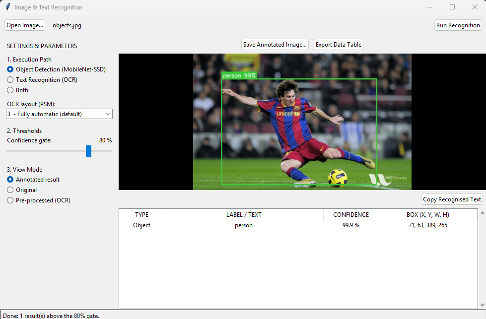
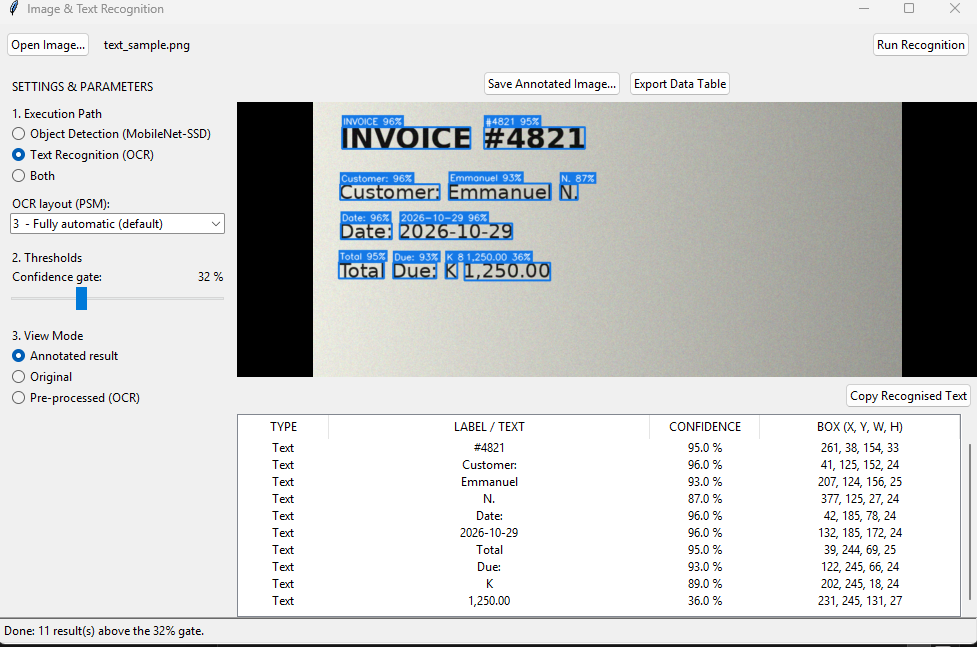

# Project 4: Image or Text Recognition 

## For use an Executable application has been packaged for easy use

### person scanned

## Setup (Windows)
1. python -m venv venv ; venv\Scripts\activate
2. python -m pip install -r requirements.txt     (needs OpenCV 4.x - OpenCV 5 has no Caffe loader)
3. Install the Tesseract program (UB-Mannheim installer, default folder C:\Program Files\Tesseract-OCR)
## Run
GUI:  python recognize_gui.py
CLI:  python recognize.py --mode detect --image samples/street.jpg
      python recognize.py --mode ocr --image samples/text_sample.png --psm 6
Check: python check_requirements.py
Models are in ./models (MobileNetSSD_deploy.prototxt / .caffemodel).

## Build the Windows application (.exe)
1. Install Python 3.12 (PyInstaller does not support the newest Python versions yet) and the
   Tesseract program (UB-Mannheim installer, default folder).
2. Double-click build_exe.bat  (needs internet the first time).
3. Result: dist\OpticNerve\OpticNerve.exe  - zip and share the whole dist\OpticNerve folder.
   Tesseract is copied into dist\OpticNerve\Tesseract-OCR so text recognition works on any PC.
